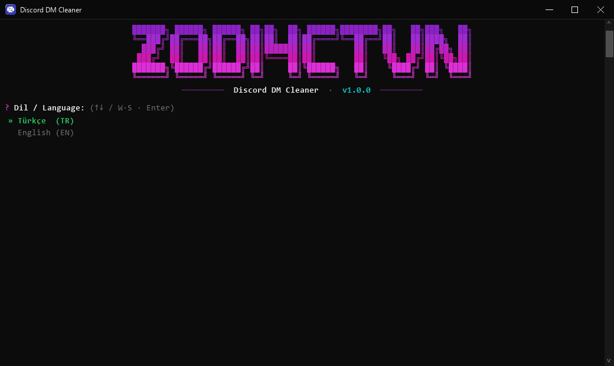
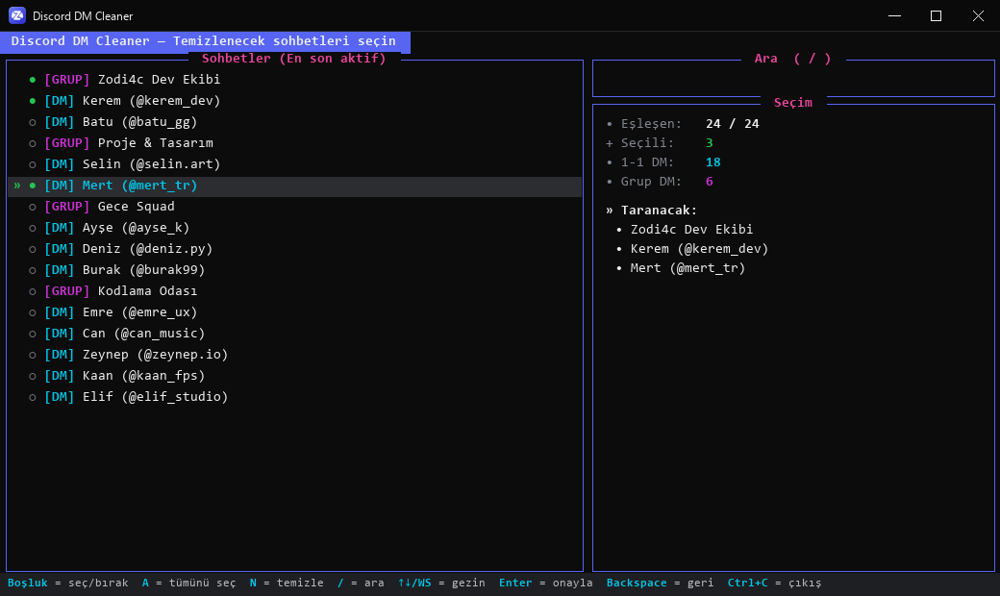
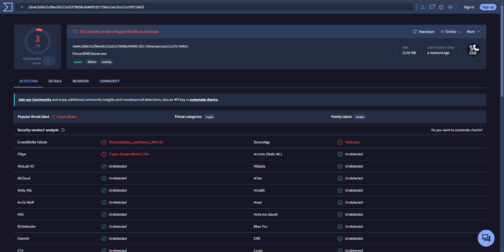
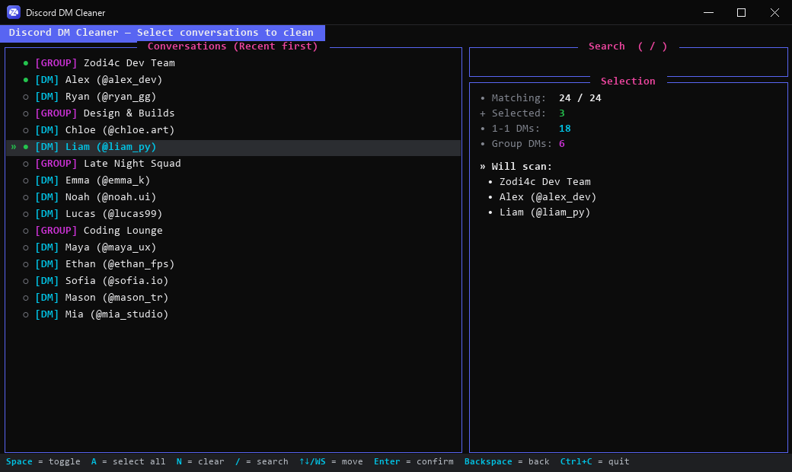

<div align="center">


# Discord DM Cleaner

**Safely delete your own Discord DM & Group DM messages — interactive CLI tool by `zodi4ctvn`**

[](LICENSE)
[](https://python.org)
[](https://docs.astral.sh/ruff/)
[](https://mypy-lang.org/)
[-brightgreen.svg)](https://www.virustotal.com/gui/file/16e4c3d0e51cf9ee56121a25379008c434097d31730ea2aec5ce21cd76719455)
[](https://github.com/zodi4ctvn)

[🇹🇷 Türkçe](#-türkçe) · [🇬🇧 English](#-english)

</div>

---

## 🇹🇷 Türkçe

<div align="center">



</div>

### Nedir?

**Discord DM Cleaner**, Discord'daki açık 1-1 özel mesajlarında (DM) ve Grup DM'lerinde **yalnızca kendi yazdığın mesajları** güvenle tarayıp temizlemeni sağlayan interaktif bir komut satırı aracıdır. Token asla diske yazılmaz — oturum sona erdiğinde `secure_wipe()` ile bellekten silinir.

### Özellikler

- 🔒 **Sıfır depolama** — Token hiçbir dosyaya, log'a veya geçmişe yazılmaz; çıkışta ve geri dönüşte bellekten silinir, panoda kaldıysa isteğe bağlı pano temizleme sorar
- 🌐 **Türkçe & İngilizce arayüz** — Başlangıçta dil seçimi (sistem dilini otomatik tanır)
- 🖱️ **Tek tıkla çalıştırma (`start.bat` / `.exe`)** — Windows'ta ilk açılışta `.venv` sanal ortamını ve bağımlılıkları otomatik kurar; ya da Python kurmadan doğrudan `DiscordDMCleaner.exe` ile çalıştırabilirsin
- 💬 **Açık 1-1 DM & Grup DM listesi** — Giriş yaptıktan sonra doğrudan açık DM ve Grup DM sohbetlerin listelenir; istediğin sohbetleri tekli veya toplu seçebilirsin
- 📅 **Tarih aralığı filtresi** — Tüm mesajlar, son `N` gün, belirli tarihten önce, belirli tarihten sonra veya iki tarih arası (`YYYY-AA-GG` / `GG.AA.YYYY`); snowflake sınırlarıyla gereksiz geçmişi taramadan hızla çalışır
- 🔍 **Discord Search API + Otomatik Fallback** — Kalabalık DM/Grup sohbetlerinde önce `/messages/search?author_id=...` ile yalnızca kendi mesajlarını 10 kata kadar hızlı bulur; 202/hata durumunda standart taramaya otomatik geçer
- 🎯 **Mesaj türü, Sabitlenenleri Koruma & Son N Mesajı Koru** — Sadece fotoğraf/dosya ekleri veya sadece linkleri hedefle, sabitlenmiş (Pinned) mesajları koru, her sohbette en yeni `N` mesajını bırak
- ⚡ **Canlı Akış Silme (Scan-while-Delete) & Adet Limiti** — İstersen 14k+ mesajın taranmasını beklemeden her 100'lük sayfa geldikçe anında sil, ya da `250 / 500 / 1.000 / Özel` parti limiti koy (1.000+ mesajda otomatik güvenlik uyarısı)
- 🔄 **Kaldığı Yerden Devam Etme (Checkpoint / Resume)** — İşlem `Ctrl+C` veya bağlantı kopmasıyla yarıda kalırsa kalan mesaj listesi `checkpoints/` içine (token olmadan!) kaydedilir; sonraki açılışta kaldığın yerden devam edebilirsin
- 👀 **Dry-Run / Önizleme modu** — Hiçbir mesaj silinmeden önce sohbet bazlı dağılımı, tahmini süreyi ve en yeni/en eski mesaj örneklerini gör; istersen silmeden çık veya sadece yedek al
- 💾 **Yerel yedekleme (JSON, TXT & Discord Karanlık Tema HTML + Medya)** — Eşleşen mesajları `backups/` klasörüne `JSON`, `TXT` veya tarayıcıda canlı arama kutulu **Discord karanlık tema `.html`** arşivi olarak kaydet; istersen ek dosya/resimleri de yerel diske indir
- 🧹 **Akıllı mesaj filtreleme** — Yalnızca kendi hesabına ait ve silinebilir mesaj tiplerini hedefler; arama kaydı, pin bildirimi veya grup değişikliği gibi sistem mesajlarını otomatik atlar
- ☑️ **İki panelli sohbet seçici** — Solda en son aktif sohbet listesi (`[DM]` / `[GRUP]`), sağda anlık arama (`/`) ve seçim özeti
- ⌨️ **Tam klavye & geri gitme desteği** — Ok tuşları yoksa `W / S` (ve `J / K`) ile gezin; `Backspace` / `Esc` ile her adımda bir önceki ekrana temizce dön
- 📋 **Kolay yapıştırma** — Yıldızlı (`*****`) token ekranında doğrudan `Ctrl+V` veya sağ tık ile yapıştır
- ✅ **Çift katmanlı onay ekranı** — Silinecek mesaj sayısını, tarih filtresini, yedek durumunu ve tahmini süreyi gör, `ONAYLA` (veya `CONFIRM`) yazarak onayla
- 🛡️ **3 katmanlı akıllı rate limit** — Discord `X-RateLimit-*` başlıklarına uyum, `os.urandom` tabanlı insan benzeri gecikmeler (`0.9–2.1 sn`, her 15 silmede `4.5–8.0 sn` mola), 429 üstel geri çekilme ve 5xx otomatik yeniden deneme
- 🎮 **Discord istemci algılama** — Kurulu Discord Stable / Canary / PTB istemcilerini otomatik algılar
- 📊 **Titremesiz canlı ilerleme** — Silinen her mesaj kalıcı olarak listelenir, altta tek satırlık ilerleme çubuğu ve sonunda özet paneli gösterilir

### Ekran Görüntüsü

<div align="center">



</div>

### Kurulum ve Kullanım

#### Windows — Hazır `.exe` (Python gerekmez)

1. [Releases](https://github.com/zodi4ctvn/discord-dm-cleaner/releases) sayfasından **`DiscordDMCleaner.exe`** dosyasını indir ve çift tıkla.
2. **SHA-256:** `16e4c3d0e51cf9ee56121a25379008c434097d31730ea2aec5ce21cd76719455`

> [!NOTE]
> **Antivirüs & VirusTotal (3/71 Yanlış Pozitif / False Positive):** [VirusTotal taramasında](https://www.virustotal.com/gui/file/16e4c3d0e51cf9ee56121a25379008c434097d31730ea2aec5ce21cd76719455) **68/71** antivirüs motoru (Microsoft Defender, Kaspersky, Bitdefender, Avast, AVG, Avira, ClamAV vb.) dosyayı tamamen temiz bulmuştur. Yalnızca 3 sezgisel/ML tarayıcının (`CrowdStrike Falcon`, `SecureAge`, `Zillya`) uyarı vermesinin sebebi:
> 1. `.exe` dosyasının **PyInstaller (`--onefile`)** kendi kendini açan (self-extracting) bootloader ile paketlenmiş olması,
> 2. Ücretli **kod imzalama sertifikası (Code Signing)** içermemesi,
> 3. Güvenlik amacıyla RAM temizleme (`secure_wipe`) ve pano temizleme için Windows `ctypes` API'lerini kullanmasıdır.
>
> Kaynak kodun tamamı açıktır — dilersen kendin inceleyip aşağıdan `start.bat` ile Python üzerinden doğrudan çalıştırabilirsin.

<details>
<summary>VirusTotal Tarama Raporu (3/71 — Görüntülemek için tıkla)</summary>



</details>

#### Windows — Kaynak koddan (tek tık)

1. [Python 3.11+](https://www.python.org/downloads/) kurulu olsun.
2. Repoyu indir ve klasördeki **`start.bat`** dosyasına çift tıkla.
3. İlk açılışta `.venv` ve paketler otomatik kurulur, ardından araç doğrudan açılır.

#### Terminal / CLI (Windows, Linux, macOS)

```bash
git clone https://github.com/zodi4ctvn/discord-dm-cleaner
cd discord-dm-cleaner
pip install -e .
ddc
```

Alternatif olarak doğrudan modül şeklinde çalıştırabilirsin:

```bash
python -m cleaner.main
```

### 🔑 Discord Token Nasıl Alınır? (En Kolay ve Güvenli Yol)

> [!IMPORTANT]
> Token almak için **asla** üçüncü parti tarayıcı eklentisi kurma veya konsola (Console) kaynağı belirsiz JavaScript kodu yapıştırma. En güvenli yöntem doğrudan tarayıcının **Ağ (Network)** sekmesidir:

1. Tarayıcında (Chrome / Edge / Brave / Firefox) **[discord.com/app](https://discord.com/app)** adresini aç ve hesabına giriş yap.
2. Klavyeden **`F12`** (veya **`Ctrl + Shift + I`**) tuşlarına basarak **Geliştirici Araçları (DevTools)** penceresini aç.
3. Üst menüden **Network (Ağ)** sekmesine geç ve filtre kısmından **`Fetch/XHR`** seçeneğine tıkla (veya filtre kutusuna `messages` yaz).
4. Discord içinde herhangi bir DM'ye veya kanala tıkla — listede `messages?limit=...` gibi bir istek görünecektir.
5. O isteğe tıkla → sağda **Headers (Üst Bilgiler)** sekmesini aç → **Request Headers (İstek Üst Bilgileri)** altında **`Authorization`** satırının karşısındaki değeri kopyala.
6. Aracı çalıştırıp token ekranında **`Ctrl + V`** ile yapıştır (yıldızlı `*****` olarak gizlenir).

> [!TIP]
> **Ekstra Güvenlik:** Token'ını kesinlikle kimseyle paylaşma. Temizlik işlemin bittikten sonra Discord'dan çıkış yapıp tekrar giriş yaparak (veya şifreni yenileyerek) o token'ı anında geçersiz kılabilirsin.

### Kısayollar

| Tuş | İşlev |
| --- | --- |
| `↑` / `↓` veya `W` / `S` | Menülerde ve sohbet listesinde gezin |
| `Space` | Sohbeti seç / seçimi kaldır |
| `A` / `N` | Görünenlerin hepsini seç / temizle |
| `/` veya `Tab` | Canlı arama kutusuna geç |
| `Backspace` / `Esc` | Önceki adıma geri dön |
| `Ctrl+V` | Token ekranında panodan yapıştır |
| `Enter` | Onayla / devam et |
| `Ctrl+C` | Güvenli çıkış (token bellekten silinir) |

### Güvenlik

- Token asla `.env`, log dosyası veya herhangi bir yapılandırma dosyasına yazılmaz
- Yalnızca 5 Discord REST endpoint'ine ham `httpx` (HTTP/2) ile bağlanır (`GET /users/@me`, `GET /users/@me/channels`, `GET /channels/{id}/messages/search`, `GET /channels/{id}/messages`, `DELETE /channels/{id}/messages/{id}`); isteğe bağlı medya indirmeleri yalnızca resmi Discord CDN alan adlarından (`cdn.discordapp.com`, `media.discordapp.net`) dosya başı 50 MB sınırı ile yapılır
- Telemetri, analitik veya `discord.com` / resmi Discord CDN dışında hiçbir ağ bağlantısı yoktur (`trust_env=False`)
- Her oturumda taze bir `X-Super-Properties` parmak izi üretilir
- HTTP 401 (iptal edilmiş/geçersiz token) alındığında işlem anında durdurulur

### ⚠️ Uyarı ve Sorumluluk Reddi

> [!CAUTION]
> - Bu araç yalnızca **kendi kullanıcı hesabın** için tasarlanmıştır; bot token'ı ile çalışmaz.
> - Kullanıcı token'ı ile otomatik işlem yapmak **Discord Kullanım Şartları'na (ToS)** aykırıdır. Araç içinde 3 katmanlı rate-limit koruması ve insan benzeri gecikmeler bulunsa da yoğun veya sık kullanım; hesabının **şüpheli hesap olarak işaretlenmesine**, **telefon/e-posta doğrulamasına düşmesine**, **geçici olarak kilitlenmesine** veya **kalıcı olarak yasaklanmasına (ban)** sebep olabilir.
> - Silinen Discord mesajları geri alınamaz (önce yerel yedek alman önerilir).
> - **Tüm risk ve sorumluluk tamamen kullanıcıya aittir.** Geliştirici (`zodi4ctvn`), bu aracın kullanımından doğabilecek hesap kısıtlaması, ban veya veri kaybından hiçbir şekilde sorumlu tutulamaz.

---

## 🇬🇧 English

<div align="center">


</div>

### What is it?

**Discord DM Cleaner** is a secure, interactive command-line tool that lets you scan and delete **only your own messages** across your open Discord 1-1 DMs and Group DMs. Your token is never written to disk — it is overwritten in memory via `secure_wipe()` when the session ends.

### Features

- 🔒 **Zero persistence** — Token is never saved to any file, log, or history; wiped from memory on exit or back navigation, with optional clipboard cleanup
- 🌐 **Turkish & English UI** — Language selector on startup (auto-detects your OS locale)
- 🖱️ **One-click Windows launcher (`start.bat` / `.exe`)** — Automatically creates `.venv` and installs dependencies on first run, or launch `DiscordDMCleaner.exe` with no Python required
- 💬 **Open 1-1 DMs & Group DMs** — Goes straight to your open DM and Group DM list right after login for fast single or multi-selection
- 📅 **Date range filtering** — All messages, last `N` days, before a date, after a date, or between two dates (`YYYY-MM-DD` / `DD.MM.YYYY`) with snowflake-bounded pagination
- 🔍 **Discord Search API + Auto Fallback** — Uses `/messages/search?author_id=...` first to find only your own messages up to 10x faster in busy Group DMs, transparently falling back to standard pagination on HTTP 202 or errors
- 🎯 **Content Type, Pinned Protection & Keep Latest N** — Target attachments/images only or links only, protect pinned messages, and keep your newest `N` messages per conversation
- ⚡ **Live Stream (Scan-while-Delete) & Batch Limits** — Optionally delete each 100-message page as it arrives without waiting for a full scan, or cap runs to `250 / 500 / 1,000 / Custom` messages (with a safety warning for 1,000+ batches)
- 🔄 **Checkpoint / Resume** — If interrupted by `Ctrl+C` or network drop, remaining message IDs (never your token!) are saved to `checkpoints/` so you can resume right where you left off on next launch
- 👀 **Dry-Run / Preview mode** — Always scans first in Standard Mode and displays a per-conversation breakdown, estimated time, and newest & oldest sample messages before touching anything
- 💾 **Local backup (JSON, TXT & Discord Dark HTML + Media)** — Export matched messages to `backups/` as `JSON`, `TXT`, or a searchable **Discord Dark Theme `.html`** archive with optional offline attachment/image downloads
- 🧹 **Smart message filtering** — Strictly targets your own deletable messages and automatically skips non-deletable system messages (calls, pin notices, group updates)
- ☑️ **Two-panel conversation picker** — Recent conversations on the left (`[DM]` / `[GROUP]`), live search (`/`) and selection preview on the right
- ⌨️ **Full keyboard & back navigation** — Supports `↑↓`, `W / S`, and `J / K` (great for 60% keyboards), plus `Backspace` / `Esc` to step back cleanly at any screen
- 📋 **Masked `Ctrl+V` paste** — Password-masked (`*****`) token prompt with direct Windows clipboard `Ctrl+V` support
- ✅ **Final confirmation screen** — Review total messages, date filter, backup path, and estimated time, then type `CONFIRM`
- 🛡️ **3-layer rate limiting** — Honors Discord `X-RateLimit-*` headers, `os.urandom`-seeded human-like delays (`0.9–2.1s`, `4.5–8.0s` rest every 15 deletes), 429 exponential backoff, and 5xx retries
- 🎮 **Client detection** — Auto-detects installed Discord Stable, Canary, and PTB clients
- 📊 **Flicker-free progress log** — Permanently prints every processed message above a single-line live progress bar, followed by a summary panel

### Screenshot

<div align="center">



</div>

### Installation & Usage

#### Windows — Standalone `.exe` (No Python required)

1. Download **`DiscordDMCleaner.exe`** from [Releases](https://github.com/zodi4ctvn/discord-dm-cleaner/releases) and double-click.
2. **SHA-256:** `16e4c3d0e51cf9ee56121a25379008c434097d31730ea2aec5ce21cd76719455`

> [!NOTE]
> **Antivirus & VirusTotal (3/71 False Positive):** On [VirusTotal](https://www.virustotal.com/gui/file/16e4c3d0e51cf9ee56121a25379008c434097d31730ea2aec5ce21cd76719455), **68/71** security vendors (including Microsoft Defender, Kaspersky, Bitdefender, Avast, AVG, Avira, ClamAV) report the file as completely clean. Only 3 heuristic/ML engines (`CrowdStrike Falcon`, `SecureAge`, `Zillya`) flag it due to:
> 1. Packaging with **PyInstaller (`--onefile`)** self-extracting bootloader,
> 2. Lack of a paid **Code Signing certificate**,
> 3. Use of Windows `ctypes` APIs for in-memory token wiping (`secure_wipe`) and optional clipboard cleanup.
>
> The entire source code is open — you can inspect it and run directly from source via `start.bat` below.

<details>
<summary>VirusTotal Scan Report (3/71 — Click to expand)</summary>


</details>

#### Windows — From source (One-click)

1. Make sure [Python 3.11+](https://www.python.org/downloads/) is installed.
2. Clone or download the repository and double-click **`start.bat`**.
3. On first launch it sets up `.venv` and installs dependencies automatically.

#### Terminal / CLI (Windows, Linux, macOS)

```bash
git clone https://github.com/zodi4ctvn/discord-dm-cleaner
cd discord-dm-cleaner
pip install -e .
ddc
```

Or run directly as a module:

```bash
python -m cleaner.main
```

### 🔑 How to Get Your Discord Token (Easiest & Safest Method)

> [!IMPORTANT]
> **Never** install third-party browser extensions or paste unknown JavaScript snippets into the DevTools Console to grab your token. The safest method is reading it directly from your browser's **Network** tab:

1. Open **[discord.com/app](https://discord.com/app)** in your browser (Chrome / Edge / Brave / Firefox) and log in.
2. Press **`F12`** (or **`Ctrl + Shift + I`**) to open **Developer Tools**.
3. Go to the **Network** tab and select the **`Fetch/XHR`** filter (or type `messages` into the filter box).
4. Click any DM or channel in Discord — a request such as `messages?limit=...` will appear in the list.
5. Click that request → open the **Headers** tab → scroll down to **Request Headers** → copy the value next to **`Authorization`**.
6. Launch the tool and press **`Ctrl + V`** at the masked (`*****`) token prompt.

> [!TIP]
> **Extra Safety:** Never share your token with anyone. Once you finish cleaning, you can log out of Discord and log back in (or change your password) to immediately invalidate that token.

### Keyboard Shortcuts

| Key | Action |
| --- | --- |
| `↑` / `↓` or `W` / `S` | Navigate menus & conversation list |
| `Space` | Toggle conversation selection |
| `A` / `N` | Select all / clear visible conversations |
| `/` or `Tab` | Focus live search |
| `Backspace` / `Esc` | Go back to the previous step |
| `Ctrl+V` | Paste from clipboard in token prompt |
| `Enter` | Confirm / continue |
| `Ctrl+C` | Graceful exit (wipes token from memory) |

### Security

- Token is never persisted to `.env`, logs, or disk
- Raw `httpx` (HTTP/2) calls to only 5 Discord endpoints (`GET /users/@me`, `GET /users/@me/channels`, `GET /channels/{id}/messages/search`, `GET /channels/{id}/messages`, `DELETE /channels/{id}/messages/{id}`); optional offline attachment downloads are strictly restricted to official Discord CDN hosts (`cdn.discordapp.com`, `media.discordapp.net`) with a 50 MB per-file cap
- Zero telemetry, zero analytics, zero network calls outside `discord.com` and official Discord CDN hosts (`trust_env=False`)
- Fresh `X-Super-Properties` fingerprint generated per session
- Aborts immediately on HTTP 401 (invalid/revoked token)

### ⚠️ Warning & Disclaimer

> [!CAUTION]
> - This tool is intended for **your own user account** only and does not support bot tokens.
> - Automating a user account violates **Discord's Terms of Service (ToS)**. Even with 3-layer rate-limit protection and human-like delays, heavy or frequent usage may cause your account to be **flagged as suspicious**, **locked for phone/email verification**, **temporarily restricted**, or **permanently banned**.
> - Deleted Discord messages cannot be recovered (taking a local backup beforehand is strongly recommended).
> - **Use at your own risk.** The author (`zodi4ctvn`) assumes no responsibility or liability for any account restrictions, bans, or data loss resulting from the use of this tool.

---

## Project Structure

```
discord-dm-cleaner/
├── src/
│   └── cleaner/
│       ├── __init__.py      # Version & author metadata
│       ├── __main__.py      # Module & PyInstaller .exe entry point
│       ├── main.py          # CLI entry point & step navigation
│       ├── api.py           # Discord REST API layer (httpx HTTP/2, Search API + Stream)
│       ├── backup.py        # Local JSON / TXT / Discord-themed HTML + media exporter
│       ├── checkpoint.py    # Token-free resume checkpoints for interrupted runs
│       ├── ui.py            # Rich + prompt_toolkit / Questionary TUI
│       ├── i18n.py          # Turkish & English localization
│       ├── integrity.py     # Zodi4c brand & attribution integrity guard
│       ├── security.py      # Masked token input, secure_wipe, fingerprint, Layer-1 limiter
│       └── utils.py         # Adaptive delays, snowflakes, date parsing, logging helpers
├── tests/
│   └── test_cleaner.py      # Unit & mock-transport async tests
├── assets/
│   ├── logo.png             # Discord-Z application logo
│   ├── icon.ico             # Multi-resolution Windows .exe icon
│   ├── demo_tr.gif          # Animated CLI walkthrough (Turkish)
│   ├── demo_en.gif          # Animated CLI walkthrough (English)
│   ├── preview_tr.png       # Two-panel DM & Group DM selector (Turkish)
│   ├── preview_en.png       # Two-panel DM & Group DM selector (English)
│   └── virustotal.png       # VirusTotal scan screenshot (3/71 false positive)
├── .github/
│   └── workflows/
│       └── ci.yml           # GitHub Actions (pytest, ruff, mypy)
├── start.bat                # One-click Windows launcher (auto-setup)
├── pyproject.toml           # Hatchling build config, dependencies, Ruff & Mypy
├── README.md
├── LICENSE                  # Custom Non-Commercial Attribution License — Zodi4c
└── .gitignore
```

---

## Development

```bash
pip install -e ".[dev]"
pytest -v
ruff check src tests
ruff format --check src tests
mypy src
```

---

## License

This project is licensed under the **[Custom Non-Commercial Attribution License](LICENSE)** — Copyright (c) 2026 **Zodi4c** ([github.com/zodi4ctvn](https://github.com/zodi4ctvn)). Personal and non-commercial use is permitted with mandatory author attribution; commercial use or rebranding is prohibited.

---

<div align="center">
Made by <a href="https://github.com/zodi4ctvn">Zodi4c (zodi4ctvn)</a> · <a href="LICENSE">Custom Non-Commercial Attribution License</a>
</div>
